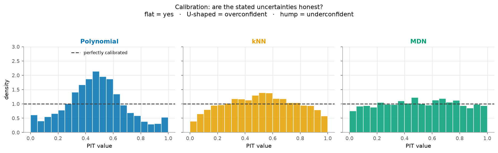
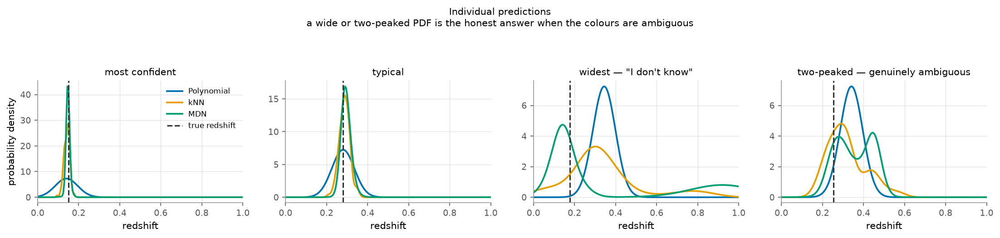

# Photometric Redshift with Calibrated Uncertainties

Estimating how far away a galaxy is from a five-colour photograph — and, the
actual point, **saying honestly how sure you are.**

Measuring a galaxy's distance properly requires a spectrum, which ties up a
large telescope for one object at a time. Photometry — brightness through five
filters — can be collected for millions of galaxies at once, but carries far
less information. Recovering redshift from those five numbers is called
**photometric redshift** (photo-z), and it is the problem this repository
tackles.

The emphasis here is not prediction accuracy. It is **calibration**: whether
the uncertainty a model reports is one you can actually trust. In astronomy,
photo-z estimates feed into downstream cosmology that propagates those error
bars, so a confidently wrong answer does more damage than an openly uncertain
one.

> **New to this?** Read **[EXPLAIN.md](EXPLAIN.md)** first. It builds the whole
> project up from zero — no astronomy assumed.

---

## Results

51,769 galaxies downloaded from SDSS DR17; 26,586 survive the quality cuts;
3,989 held out for testing. Full numbers in
[`results/metrics.json`](results/metrics.json).

| method | sigma_NMAD ↓ | bias | outliers ↓ | CRPS ↓ | PIT KS ↓ | coverage err ↓ |
|---|---|---|---|---|---|---|
| Polynomial (1995) | 0.0236 | +0.0057 | 0.93% | 0.0248 | 0.167 | 0.166 |
| k-nearest neighbours | 0.0210 | −0.0009 | 1.03% | 0.0204 | 0.066 | 0.073 |
| **Mixture Density Network** | **0.0180** | **+0.0002** | **0.80%** | **0.0180** | **0.029** | **0.022** |

The MDN wins on every measure, but the interesting margin is calibration, not
accuracy: it is **5.7× better than the polynomial on the PIT KS statistic**
while being only 1.3× better on scatter. The baselines are not embarrassing at
predicting redshift. They are embarrassing at knowing how wrong they are.

`sigma_NMAD ≈ 0.018` is in the range published SDSS photo-z studies report for
this kind of sample, which is the sanity check that the pipeline is doing
something real rather than something broken.

### The result that matters most

Train on the **brightest 50%** of galaxies, then apply to the **faintest 25%** —
which is what actually happens in deployment, because spectroscopic labels only
exist for bright objects.

| MDN evaluated on | sigma_NMAD | bias | outliers | PIT KS |
|---|---|---|---|---|
| random split (the flattering number) | 0.0180 | +0.0002 | 0.80% | 0.029 |
| **bright → faint (the honest number)** | **0.1066** | **−0.0911** | **28.3%** | **0.492** |

Scatter degrades **5.9×**. Catastrophic outliers go from 0.8% to **28%**. The
bias turns sharply negative: the model systematically places faint galaxies
*closer* than they are, because it never saw distant ones during training. And
calibration collapses entirely — PIT KS of 0.49 means the uncertainties are no
longer meaningful at all.

**A model that looks excellent on a random split is nearly unusable on the
population it was built for.** Any photo-z number quoted without saying which
split produced it should be treated with suspicion — including the good one in
the table above.

### The headline figure



This is the calibration test. For every galaxy, we ask where its true redshift
fell inside the predicted distribution. **If a model is honest, the truth lands
at every percentile equally often, so the histogram should be flat.**

Read the shape:

| shape | meaning |
|---|---|
| flat | honest |
| U-shaped (piled at the edges) | **overconfident** — PDFs too narrow |
| humped in the middle | underconfident — hedging too much |
| sloped | biased high or low |

### Why a distribution instead of a number



The third panel is the argument for this entire project. The polynomial
baseline produces a confident, narrow peak — in the wrong place. The mixture
density network instead spreads its probability and places a peak near the
truth. Both "got it wrong" by a point-estimate metric. Only one of them told
you not to trust it.

A wide or two-peaked PDF is not a failure. Some galaxies genuinely have colours
consistent with two very different distances, and a single number cannot say so.

### Everything else

| figure | shows |
|---|---|
| [`coverage.png`](results/coverage.png) | when the model says 90% confident, is it right 90% of the time? |
| [`scatter_zphot_zspec.png`](results/scatter_zphot_zspec.png) | predicted vs true redshift, with the catastrophic-outlier boundary |
| [`metric_comparison.png`](results/metric_comparison.png) | the four headline metrics side by side |
| [`mdn_training.png`](results/mdn_training.png) | training curve and the early-stopping point |

---

## Quickstart

```bash
git clone <this repo>
cd 01-photoz-calibrated

python -m venv .venv
source .venv/bin/activate          # Windows: .venv\Scripts\activate
pip install -r requirements.txt

python run_all.py --fetch          # download real SDSS data, then run everything
```

Other entry points:

```bash
python run_all.py                  # reuse cached data (or synthetic if none)
python run_all.py --synthetic      # offline, ~1 min, no download
python -m pytest tests/ -q         # 22 tests
```

The download is resumable. SkyServer is a free public service and times out
fairly often; each sky slice is cached as it arrives, so re-running picks up
where it stopped rather than starting over.

---

## The three methods

Two of them are deliberately not machine learning. **Build the baseline first**
is a rule in this field, because without it you cannot answer the only question
that matters: *is the neural network buying anything over what we already had?*

**1. Polynomial fit** (Connolly et al. 1995) — a cubic polynomial from colours
to redshift. Its PDF is a Gaussian whose width is the training residual
scatter, which means **every galaxy gets the same uncertainty** regardless of
whether it is bright and obvious or faint and ambiguous. That is obviously
wrong, and the calibration plots show precisely what it costs.

**2. k-nearest neighbours** — find the 100 most similar galaxies in colour
space that have known redshifts; their redshift distribution is the answer.
Simple, but the uncertainty **emerges from the data** rather than being
assumed: neighbours agree → narrow PDF; neighbours disagree → wide or
two-peaked PDF.

**3. Mixture Density Network** — a neural network that outputs the parameters
of a mixture of 5 Gaussians instead of a single number. Trained by maximising
the likelihood of the true redshift, not by mean squared error. That loss
punishes overconfidence automatically: a narrow peak in the wrong place is
enormously expensive, so the network learns honest widths.

---

## How the methods are scored

Accuracy alone cannot tell you whether a model worked, so four things are
measured:

| metric | question it answers |
|---|---|
| **PIT** (+ KS statistic) | are the stated uncertainties honest? |
| **Coverage** | does a stated X% interval contain the truth X% of the time? |
| **CRPS** | how good is the whole distribution? Rewards being sharp *and* correct, so it cannot be gamed by hedging. |
| **sigma_NMAD**, bias, outlier fraction | the standard photo-z point-estimate statistics |

Two conventions worth knowing, because they signal whether someone has read
the photo-z literature:

- errors are always `Δz = (z_pred − z_true) / (1 + z_true)`, never the raw
  difference — redshift uncertainty naturally scales with `(1+z)`
- `sigma_NMAD` uses the median absolute deviation, so a few catastrophic
  failures cannot inflate it; those are reported separately as the outlier
  fraction (`|Δz| > 0.15`)

---

## The experiment that matters most

Everything above uses a random train/test split, and **a random split flatters
the model.**

Spectroscopic redshifts exist only for galaxies someone pointed a big telescope
at — the **bright, nearby** ones. But the model gets applied to the galaxies we
*lack* spectra for: the **faint, distant** ones. Training set and target are
systematically different populations, and a random split hides that entirely by
putting bright and faint galaxies on both sides.

So `run_all.py` also runs the honest version: **train on the brightest 50%,
test on the faintest 25%.** Performance degrades measurably. That degradation
is the real-world number.

This is not a detail — it is one of the main reasons photo-z is still an open
research problem rather than a solved one.

---

## Repository layout

```
run_all.py              end-to-end: fetch -> fit -> evaluate -> figures
src/photoz/
  data.py               SDSS SkyServer queries (resumable) + synthetic fallback
  features.py           dereddening, colours, quality cuts, splits
  baselines.py          polynomial and kNN non-ML baselines
  mdn.py                mixture density network (PyTorch)
  metrics.py            PIT, CRPS, coverage, photo-z point statistics
  plots.py              all figures
tests/                  22 tests, including CRPS against its closed form
results/                figures and metrics.json
EXPLAIN.md              the project explained from zero
```

---

## Notes on the implementation

**Dereddening.** Dust in our own galaxy reddens everything we observe, and
reddening is exactly the signal we are trying to measure. SDSS's per-band
extinction estimate is subtracted before computing colours. Skip this and you
imprint the Milky Way's dust map onto your redshift predictions.

**Colours, not magnitudes.** Observed brightness confounds distance with
intrinsic luminosity. Colour — the *ratio* between filters — mostly cancels
that out and tracks the shape of the spectrum, which is where the redshift
information lives. One magnitude (`r`) is retained because at fixed colour, a
fainter galaxy is on average further away.

**CRPS is integrated carefully.** The CRPS integrand has a jump discontinuity
at the true redshift. Integrating straight across it with the trapezoid rule
smears the jump over one grid cell and leaves a ~0.6% error — large enough to
change how methods rank. The integral is therefore split at the true value, so
both pieces are smooth. `tests/test_metrics.py` verifies the result against the
closed-form Gaussian CRPS and checks that refining the grid drives the error
toward zero.

**The tests check the science, not just the plumbing.** A correctly specified
model is verified to produce flat PIT; a deliberately overconfident one is
verified to produce the U shape. If those tests pass, the calibration
machinery is measuring what it claims to.

---

## Where this goes next

**Template fitting** is the obvious extension and the most valuable one. It is
the third major family of photo-z methods and needs *no training data at all*:
take model spectra of real galaxy types, mathematically redshift them, compute
what colours they would produce at each trial redshift, and ask which redshift
best reproduces what was observed. The chi-squared curve converts directly into
a P(z).

It is not implemented here because it requires an external library of galaxy
spectral templates plus the SDSS filter response curves. It would make the
baseline comparison complete, and — because it is physics rather than
interpolation — it should degrade far more gracefully on the faint galaxies
where the empirical methods suffer most.

Other directions, roughly in order of value:

- **Use the per-galaxy photometric errors.** SDSS reports an uncertainty on
  every magnitude. Right now they are only used for quality cuts, not fed to
  the models. A faint galaxy's colours are much less certain than a bright
  one's, and the models should know that.
- **Recalibration.** Even a good model can be systematically overconfident;
  conformal prediction or a post-hoc PIT-flattening step would fix the
  remaining miscalibration without retraining.
- **Mitigate the selection bias** rather than only measuring it — importance
  weighting or domain adaptation from the bright training set to the faint
  target population.

---

## Data

SDSS DR17, queried from the public SkyServer. Galaxies with reliable
spectroscopic redshifts (`zWarning = 0`) and clean photometry (`clean = 1`),
`0.01 < z < 1.0`, `14 < r < 21`. The exact query is in
[`src/photoz/data.py`](src/photoz/data.py) and the data release is pinned, so
the sample is reproducible.

**The quality cut removes 49% of the sample, and that is not neutral.** Almost
all of it comes from one band: requiring a magnitude error below 0.5 drops 48%
of galaxies on the **u band** alone, versus under 1% for every other band.
SDSS's u filter is its least sensitive — atmosphere and detector both work
against near-ultraviolet light.

This matters because the cut is correlated with exactly the thing being
studied. Galaxies that are faint in u are preferentially faint, red and
distant — the population the model already handles worst. So the cleaning step
*compounds* the selection bias measured above rather than being independent of
it. Loosening the threshold keeps more faint galaxies at the cost of noisier
colours; it is exposed as a parameter (`max_magerr`) because that tradeoff is a
real experiment, not a settled question.

Running with `--synthetic` generates a fake catalogue instead. It exists so the
pipeline and tests can run offline, and it is labelled loudly in the output —
**no scientific claim can be made from it.**

Funding and acknowledgements for SDSS: <https://www.sdss4.org/collaboration/citing-sdss/>

## License

MIT.
